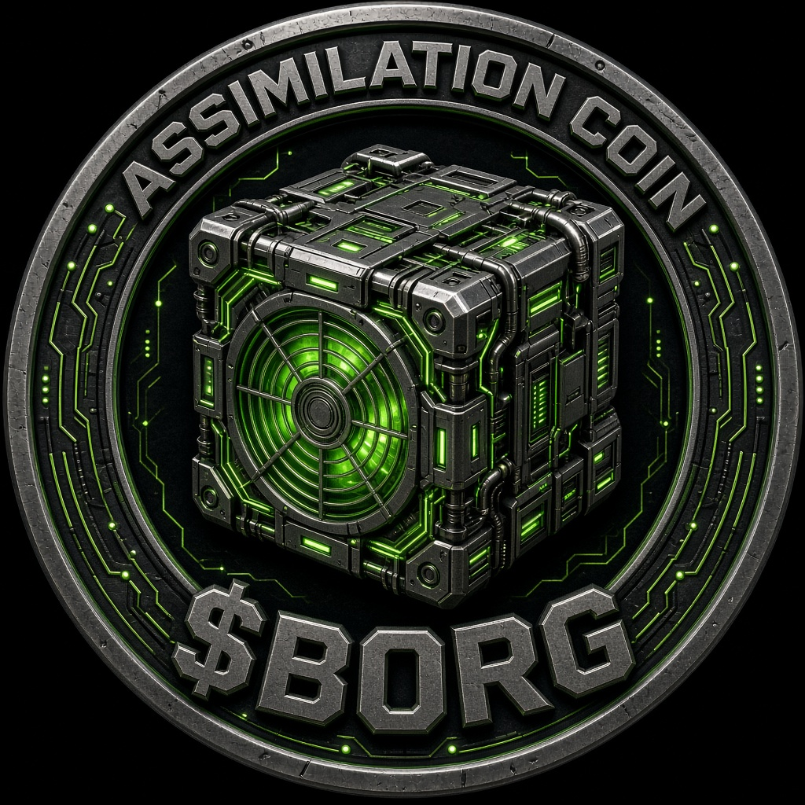

<p align="center">
  
</p>

# Assimilation Coin (B0RG)

## ⬇️ Download the Wallet

**[Download B0RG Wallet v1.0.0 for Windows](https://github.com/b0rg-collective/b0rg/releases/download/v1.0.0/b0rg-win64.zip)** · [Linux node + wallet](https://github.com/b0rg-collective/b0rg/releases/download/v1.0.0/b0rg-phase1-linux-x86_64.tar.gz) · [All downloads and checksums](https://github.com/b0rg-collective/b0rg/releases/tag/v1.0.0)

For Windows, unzip and run `b0rg-qt.exe`.

Assimilation Coin is a Litecoin Core v0.21.4 fork. The ticker is **B0RG** (a zero, not the letter O). Proof of work is Kadena-compatible BLAKE2s-256, so Blake2s ASICs such as the Antminer KA3 and the Goldshell KD5, KD6, and KD-Box can mine it on factory firmware. MWEB privacy is opt-in. The desktop wallet calls the coin **drones**.

Run a node: see [NODE.md](NODE.md)

Join the community on Discord: [discord.gg/MMEmvu3rj](https://discord.gg/MMEmvu3rj)

| | |
|---|---|
| Website | [shed-p00l.com](https://shed-p00l.com) |
| White paper | [WHITEPAPER.md](WHITEPAPER.md) ([PDF](WHITEPAPER.pdf)) |
| Block time | 30 seconds |
| Supply | 7,000,000,009 B0RG, no premine |
| Subsidy | 1,750 B0RG, halving every 2,000,000 blocks. Block 1 pays 1,759.28 |
| Maturity | 100 blocks |
| Ports | P2P **19333**, RPC **19332** |

The consensus rules, the 286-byte work header, address prefixes, and the risk statement are in the white paper. Do not treat this README as an offer to sell coins.

## Build on Linux

Ubuntu 24.04 packages:

```bash
sudo apt-get install build-essential libtool autotools-dev automake pkg-config \
  bsdmainutils python3 libssl-dev libevent-dev libboost-system-dev \
  libboost-filesystem-dev libboost-thread-dev libboost-test-dev \
  libdb5.3++-dev libsqlite3-dev libfmt-dev
```

Add `qtbase5-dev qttools5-dev` only if you want the Qt wallet.

```bash
./autogen.sh
./configure --with-incompatible-bdb --without-gui
make -j"$(nproc)"
```

Binaries are `src/b0rgd`, `src/b0rg-cli`, `src/b0rg-tx`, and `src/b0rg-wallet`. For the desktop wallet, configure with `--with-gui=qt5` instead of `--without-gui`. `b0rg-qt` is written to `src/qt/b0rg-qt`. The icon and splash use `share/pixmaps/b0rg-logo.jpg`.

## Cross-compile for Windows

The depends system builds a static x86_64 wallet, including Qt. On Debian or Ubuntu, install `g++-mingw-w64-x86-64` (the posix thread model). From a clean tree:

```bash
make -C depends -j"$(nproc)" HOST=x86_64-w64-mingw32
./autogen.sh
CONFIG_SITE="$PWD/depends/x86_64-w64-mingw32/share/config.site" \
  ./configure --prefix=/
make -j"$(nproc)"
```

That produces `src/b0rgd.exe`, `src/b0rg-cli.exe`, and `src/qt/b0rg-qt.exe`. They link only Windows system DLLs. On Windows the data directory is `%APPDATA%\B0RG` and the config file is `b0rg.conf`.

## Quick start

There are no DNS seeds. A mainnet node needs a peer. The public pool node listens on port 19333:

```
addnode=pool.shed-p00l.com
```

Put that in `~/.b0rg/b0rg.conf` (or `%APPDATA%\B0RG\b0rg.conf`), or pass `-addnode=pool.shed-p00l.com`. RPC authentication is the cookie file the node writes. Do not commit a config that contains an RPC password.

```bash
src/b0rgd -daemon -addnode=pool.shed-p00l.com
src/b0rg-cli createwallet "shed"
src/b0rg-cli -rpcwallet=shed getnewaddress
src/b0rg-cli -rpcwallet=shed getnewaddress "private" mweb
```

| Network | Data directory | P2P | RPC | Bech32 | MWEB |
|---|---|---|---|---|---|
| main | `~/.b0rg` | 19333 | 19332 | `borg` | `borgmweb` |
| test (`-chain=test`) | `~/.b0rg/testnet` | 29333 | 29332 | `tborg` | `tborgmweb` |
| regtest (`-chain=regtest`) | `~/.b0rg/regtest` | 19433 | 19432 | `rborg` | `rborgmweb` |

Mainnet transparent addresses start with `B` (P2PKH, version 25) or `D` (P2SH, version 30). The Qt wallet shows **DRONES**, **mDRONES**, **µDRONES**, and **zaps** (1 zap = 1 satoshi). Those labels are display-only.

SegWit and MWEB are active from height 1. Sending to a `borgmweb1…` address pegs in. Sending from an MWEB balance to another MWEB address stays inside the extension block. Sending from MWEB to a transparent address pegs out. On regtest, `-fallbackfee=0.0002` lets `sendtoaddress` work before fee estimates exist.

## Mining

Point factory Kadena firmware at the public pool. Username is your B0RG address. Password is ignored (`x` is fine).

| Mode | URL |
|---|---|
| PROP, 1% fee | `stratum+tcp://pool.shed-p00l.com:3340` |
| SOLO | `stratum+tcp://pool.shed-p00l.com:4340` |

To run the same server yourself, against a local node:

```bash
python3 stratum/b0rg_stratum.py \
  --rpc-url http://127.0.0.1:19332 \
  --rpc-cookie ~/.b0rg/.cookie \
  --fee-address 'B…' --fee-percent 1
```

PROP listens on 3340, SOLO on 4340, and a JSON stats page on 19340. A CPU check, with no hardware:

```bash
python3 stratum/test_miner.py --port 4340 --user 'borg1…worker' --blocks 1
```

## Tests

```bash
src/test/test_litecoin --run_test=b0rg_tests
```

`b0rg_tests` checks the 7,000,000,009 supply, the 286-byte header against `hashlib.blake2s`, and LWMA. `stratum/integration_test.py` mines on regtest through Stratum and then pegs in, sends MWEB to MWEB, and pegs out.

## Community

Join the community on Discord: [discord.gg/MMEmvu3rj](https://discord.gg/MMEmvu3rj)

## License

[MIT](LICENSE). The same text is in [COPYING](COPYING), which is the file the source headers name. Copyright (c) 2009-2021 The Bitcoin Core developers, Copyright (c) 2009-2021 Bitcoin Developers, Copyright (c) 2011-2021 The Litecoin Core developers, and Copyright (c) 2026 The Assimilation Coin developers. Those upstream notices stay in both files and in the source files that carry them. Third-party libraries under `src/` keep their own licenses (`src/secp256k1-zkp/COPYING`, `src/leveldb/LICENSE`, `src/univalue/COPYING`, `src/libmw/LICENSE`, `src/crypto/ctaes/COPYING`).
